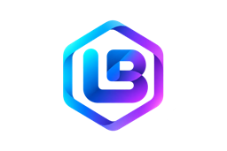
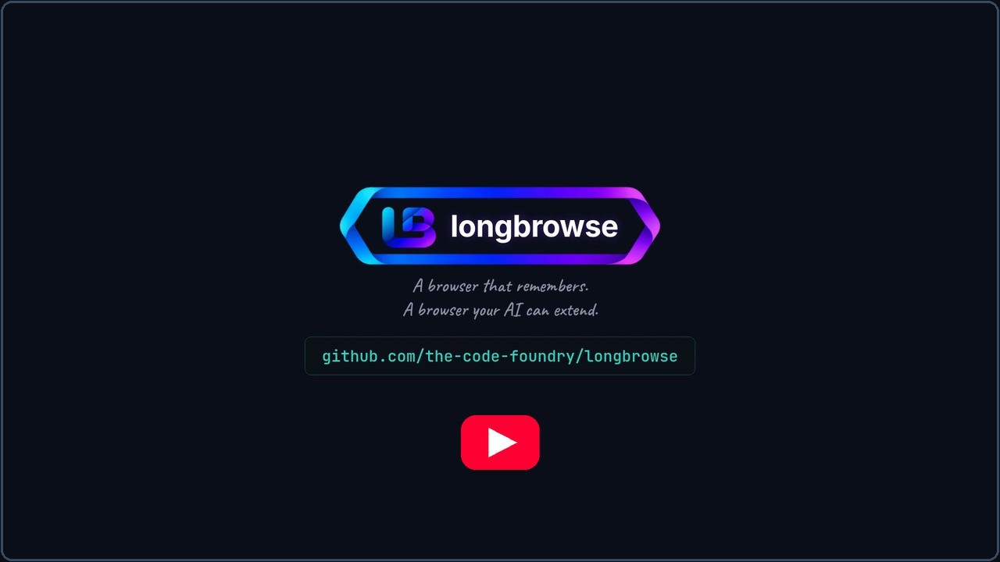

<p align="center"></p>

# What is longbrowse?

A persistent browser for AI agents: one container with Chromium (Playwright), an MCP server
(streamable HTTP), a REST API, a live noVNC view, and hot-reloaded site plugins.

<p align="center"><a href="https://youtu.be/53bgvNN8wWM"></a><br>
<sub>▶ Watch the 4-minute intro on YouTube</sub></p>

The idea: your agent keeps long-lived, logged-in browser sessions (web chat apps, webmail,
Jira, Confluence — any site that allows automation), and site-specific logic lives in small
plugin folders you can edit while the server runs.
Each plugin gets its own browser profile — logins never bleed between sites — and registers its
own MCP tools next to the generic browser tools.

## Built on longbrowse: longbrowse-lend

[longbrowse-lend](https://github.com/the-code-foundry/longbrowse-lend) is a Chrome extension plus a
longbrowse plugin. You put a tab in a tab group, and that site's login is lent to a longbrowse box.
The AI then browses the site as you, without ever seeing the cookies, and you take the loan back
whenever you like.

## Example of possible usages

Ideas for plugins, from what the core already offers (profiles, events, queues, live view, egress
control). Not all of these exist yet.

- **Chat integration** — a web chat app (WhatsApp Web, Messenger, Slack, Discord, a support inbox) as
  MCP tools: read conversations, send replies, and get new messages as events or webhooks from the
  captured browser notifications.
- **Shopping** — keep a logged-in shop session: watch prices and stock, fill a cart, track orders.
  The final "buy" can wait for a person, who confirms it in the live view.
- **Uptime and journey monitoring** — run a real login, search or checkout on a schedule, and record
  the time each step takes. When a step fails, save a screenshot and raise an event. It catches
  what a plain HTTP ping misses: broken scripts, login walls, cookie banners.
- **Automated scraping** — read pages that need a login or JavaScript, with an egress allowlist per
  profile, a disk queue for jobs, and pause when idle to give the RAM back.
- **Back-office work for apps without an API** — tickets, wikis, intranet forms, supplier portals:
  turn the clicks people repeat every day into tools an agent can call.
- **Hand-off to a person** — the agent stops at a CAPTCHA, a 2FA prompt or a risky step; a person
  finishes it in the noVNC view, and the agent carries on in the same session.
- **QA and visual checks** — screenshots of whole pages, boxes or elements, compared between
  releases.

## Features

- **MCP server, no wrapper** — streamable HTTP on `/mcp`, written directly against the MCP SDK.
  Generic tools: `navigate`, `snapshot` (accessibility tree with query/depth/interactive
  filters), `click`, `type`, `press`, `screenshot` / `screenshot_box` / `screenshot_element`,
  `upload`, `download`, `tabs`, `cookies`, `proxy`, `events_tail`, `egress`.
- **Plugins, hot-reloaded** — a plugin is a folder with `manifest.json` + `tools.js`; drop it in
  `plugins/`, tools appear (`tools/list_changed`); edit a file, it reloads. No build step, no
  node_modules per plugin. See [help/plugins.md](help/plugins.md).
- **One profile per plugin** — `launchPersistentContext` per profile dir; sessions survive
  restarts via a docker volume.
- **Live view** — headful Chromium on Xvnc, watchable (and drivable) from a browser via noVNC.
  Optional `VNC_PASSWORD`, kiosk mode, configurable screen size, browser window filling the
  screen. A plugin can switch the web viewer on and off at run time. `HEADLESS=1` to skip it.
- **Pause to save RAM** — with `ALLOW_PAUSING=1`, the `pause` tool closes every browser and the
  display; `unpause` brings the display back and browsers relaunch on their next use.
- **Locked-down profiles** — `SEALED_PROFILES` makes the `cookies` tool refuse a profile, and
  `EPHEMERAL_PROFILES` keeps a profile in memory only: nothing it sees is written to disk. A plugin
  can set the profile's locale, timezone, user agent and headers (`browser.setOptions`).
- **REST API** — every MCP tool also at `POST /api/tool/<name>`, plus a status page and
  per-plugin HTTP routes and UI pages. Bearer auth via `API_TOKEN`; MCP auth via `MCP_TOKEN`.
  Plugin routes and pages can be public when they check their own credentials (a PIN, a device
  token); `/health` answers probes without a token.
- **Branding kit** — the LB logo, the ribbon frame cut for any text length, and a small UI style
  sheet, served read-only at `/brand/` so plugin pages can use them. See [brand/](brand/README.md).
- **Event store and disk queues** — per-plugin append-only events (SQLite, pruned, cursorable
  with `events_tail`) and a crash-safe disk queue, so agents can poll or be webhooked instead of
  holding a connection.
- **Egress control** — optional per-profile SOCKS5 layer inside the process: every browser
  connection is checked against a per-profile allowlist (`EGRESS=log` or `enforce`), with denied
  hosts logged as events. A plugin manifest can declare its `domains`.
- **Human pacing & watchdog** — per-profile action pacing on a slow random wave (for sites that
  frown on robots), and a watchdog that relaunches a crashed profile browser.

## Quick start

```sh
docker compose up -d
# MCP endpoint:   http://127.0.0.1:41931/mcp
# live view:      http://127.0.0.1:41932/vnc.html
# REST + status:  http://127.0.0.1:41933/
bash tests/run.sh   # unit tests always; integration tests where Chromium exists (or in the image)
```

Everything binds loopback by default. The MCP endpoint, the VNC view and the REST API are all
full control of every logged-in site — set `MCP_TOKEN`, `API_TOKEN` and `VNC_PASSWORD` before
exposing any port beyond localhost.

## Writing a plugin

```
plugins/hello/
  manifest.json    {"name": "hello", "profile": "hello", "start_url": "https://example.com"}
  tools.js         export async function register(api) {
                     api.tools.add('shout', {description: 'read the h1'}, async () => {
                       const page = await api.page();
                       return await page.locator('h1').innerText();
                     });
                   }
```

That registers the MCP tool `hello_shout`. The `api` object also gives you `z` (zod schemas),
`events`, `queue`, `settings`, `notifications` (captured Web Notifications), `http.route`,
`ui.page`, `human` (paced delays), `egress`, `tools.call`, `tools.hide`, `tools.intercept`,
`browser.setOptions`, `viewer`, and `selectors.json` support so a site redesign is a
one-file fix. Full contract: [help/plugins.md](help/plugins.md) and [docs/index.md](docs/index.md).

Plugins are trusted, in-process code. Containment is the container boundary and the egress
layer, not the loader.

## Configuration

All knobs are environment variables (see `docker-compose.yml` and `core/config.js`):
`HEADLESS`, `KIOSK`, `SCREEN`, `MAX_TABS`, `STICKY_TAB`, `MCP_TOKEN`, `API_TOKEN`,
`TOOL_PREFIX` (namespace all tool names, for several containers behind one MCP aggregator),
`TIMEZONE`, `LOCALE`, `STEALTH_PROFILES` (fingerprint alignment; see help/README.md),
`VNC_PASSWORD`, `EGRESS` (`off|log|enforce`), `WATCHDOG`, `EVENTS_KEEP`, `HUMAN_BASE_APM`,
`HUMAN_CAP_APM`, `API_PLUGIN_EDITING_ALLOWED`, `MCP_PLUGIN_EDITING_ALLOWED`, `ALLOW_PAUSING`,
`SEALED_PROFILES`, `EPHEMERAL_PROFILES`, `DEFAULT_REDIRECT`, `PLUGIN_POLL`, `PLUGIN_WATCH`.

## Docs

- [docs/index.md](docs/index.md) — how the core works, file by file
- [help/plugins.md](help/plugins.md) — the plugin contract
- [help/api.md](help/api.md) — the REST API
- `help` MCP tool — the same pages, queryable by the agent at run time

## License

[MIT](LICENSE)
